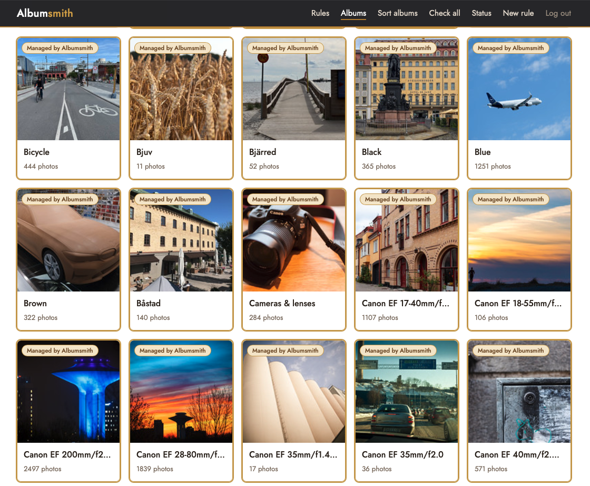
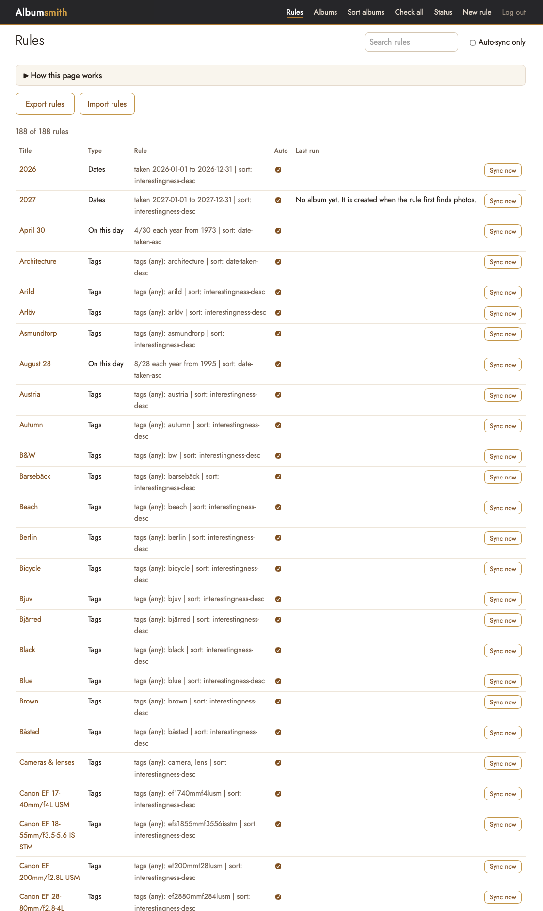
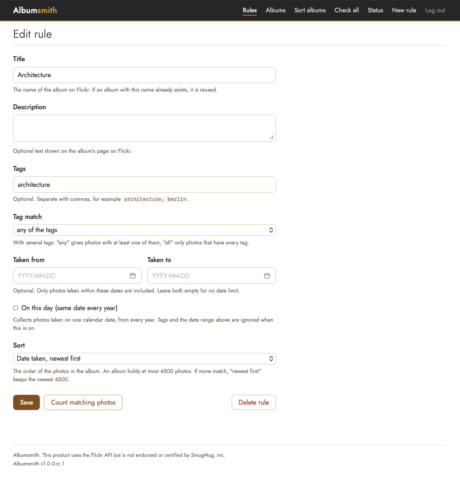
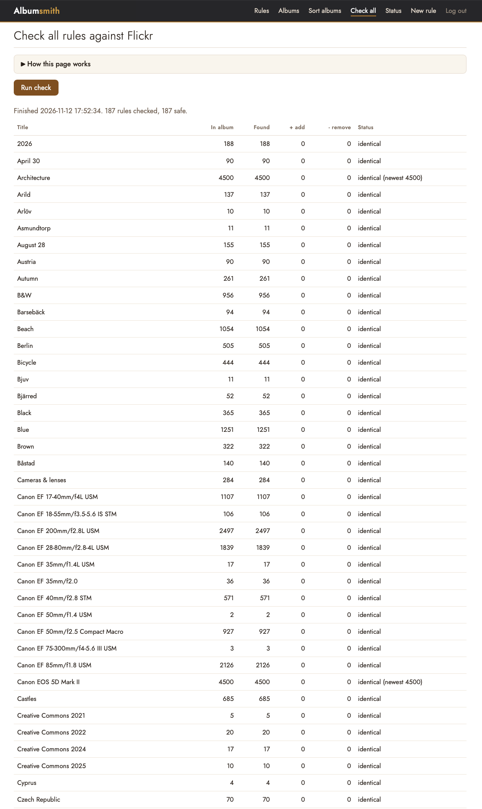

# Albumsmith

Self-hosted manager for rule-based "smart" albums on Flickr.

You describe an album with a rule (tags, a date range, "on this day", who can see the photos, a sort order) and Albumsmith keeps the matching Flickr album up to date, every night or whenever you ask it to. It runs as one small container, stores everything in a single data folder, and talks to Flickr with your own API key.

> This product uses the Flickr API but is not endorsed or certified by SmugMug, Inc.

## Features

- **Rules instead of manual albums.** Match photos by tags (any or all), taken-date range, or a day of the year across several years ("on this day"). You can also limit a rule to photos with a given Flickr visibility (public, friends only, family only, friends and family, or private), on its own or together with the other criteria.
- **Sort order.** Interestingness, date taken (oldest first) or date taken (newest first). The order is applied to the album each time it is synced.
- **Preview before you change anything.** "Check all" shows what each rule would add or remove, without touching Flickr.
- **Nightly sync.** Albums with Auto switched on are synced once a night at a time you choose.
- **Safety check.** If a nightly run would shrink an album a lot (more than 10% and more than 5 photos), that album is left alone and flagged on the Status page.
- **Managed albums are easy to tell apart.** On the Albums page, albums managed by Albumsmith have a gold frame and a "Managed by Albumsmith" label, and you can filter on managed or not managed. Your own manual albums are never touched.
- **Delete rule.** Stops managing an album. The album and its photos stay on Flickr as a normal album.
- **Export, import and automatic backups** of your rules.
- **Single owner, no accounts.** The first person to complete setup owns the instance.

## Screenshots


*Albums managed by Albumsmith are marked with a gold border and a label.*


*All rules in one place, with a status and a photo count per rule.*


*Each rule describes which photos belong in an album, with help texts for every field.*


*"Check all" compares every rule against Flickr without changing anything.*

## Requirements

- Docker with Docker Compose
- A Flickr account
- Your own Flickr API key and secret (free for non-commercial use): <https://www.flickr.com/services/apps/create/>

Each person uses their own key. Albumsmith does not ship with one.

## Quick start

```bash
mkdir albumsmith && cd albumsmith
curl -O https://raw.githubusercontent.com/hakandahlstrom/albumsmith/main/docker-compose.yml
curl -o .env https://raw.githubusercontent.com/hakandahlstrom/albumsmith/main/.env.example
mkdir -p data && sudo chown 1000:1000 data
```

Edit `.env` and set at least:

```
FLICKR_KEY=your-key
FLICKR_SECRET=your-secret
BASE_URL=http://your-server:8765
```

`BASE_URL` is the address you will open Albumsmith at, with no trailing slash. Flickr sends you back to `BASE_URL/auth/callback` after you authorise. If Flickr asks for a callback URL when you create the API key, use that address.

Start it:

```bash
docker compose up -d
docker compose logs albumsmith
```

### First-time setup

1. Open `BASE_URL` in your browser.
2. The setup page asks for a **setup code**. It is printed in the container log (`docker compose logs albumsmith`). You can also choose your own with `SETUP_CODE` in `.env`.
3. Enter the code, then authorise Albumsmith on Flickr.
4. Go to **Rules**, create your first rule and press **Sync now**.

The setup code protects an instance that nobody has claimed yet, so a stranger who finds your server first cannot take it over. After setup it is no longer used.

## Configuration

All settings are environment variables, usually set in `.env`.

| Variable | Required | Default | Description |
|---|---|---|---|
| `FLICKR_KEY` | yes | | Your Flickr API key |
| `FLICKR_SECRET` | yes | | Your Flickr API secret |
| `BASE_URL` | yes | | Public address of Albumsmith, no trailing slash. An `https://` address turns on secure cookies |
| `SESSION_SECRET` | no | generated | Secret for session cookies. If empty, one is generated and kept in the data folder |
| `SETUP_CODE` | no | random | Your own first-time setup code |
| `TRUST_PROXY` | no | `1` | Number of reverse proxies in front of Albumsmith. Only used with an `https://` `BASE_URL` |
| `SYNC_TIME` | no | `03:30` | Time of the nightly sync (24h, in the container's time zone) |
| `TZ` | no | UTC | Time zone, for example `Europe/Stockholm` |
| `NOTIFY_URL` | no | | Optional notification URL (for example an ntfy topic) |
| `NOTIFY_TOKEN` | no | | Optional bearer token sent to `NOTIFY_URL` |
| `ALBUMSMITH_PORT` | no | `8765` | Host port, used by `docker-compose.yml` |
| `PORT` | no | `3000` | Port inside the container |
| `DATA_DIR` | no | `/data` | Data folder inside the container |

## Running behind a reverse proxy

Albumsmith speaks plain HTTP. For HTTPS, put a reverse proxy in front of it, set `BASE_URL` to the public `https://` address, and make sure the proxy sends `X-Forwarded-Proto`. Most proxies do by default.

**Caddy**

```
albums.example.com {
    reverse_proxy albumsmith:3000
}
```

**Traefik** (labels on the service; adjust the network, entrypoint and resolver names to your setup)

```yaml
labels:
  - traefik.enable=true
  - traefik.http.routers.albumsmith.rule=Host(`albums.example.com`)
  - traefik.http.routers.albumsmith.entrypoints=websecure
  - traefik.http.routers.albumsmith.tls=true
  - traefik.http.services.albumsmith.loadbalancer.server.port=3000
```

**Nginx Proxy Manager:** add a proxy host that forwards to the container on port 3000 and enable SSL.

Albumsmith has a single owner and is meant for your own use. If it is reachable from the internet, put it behind your usual access control as well.

## Backup and restore

Everything lives in the data folder (`./data`): your rules, the Flickr token, run history and session secret.

- **Back up** the whole `data` folder with your normal backup tool.
- **Rules only:** on the Rules page, **Export** downloads your rules as a file and **Import** reads one back, with a preview of what will change.
- Albumsmith also keeps rotating backups of your rules in `data/backups/` (the 20 most recent).

To restore on a new machine, start Albumsmith with the copied `data` folder, or do a fresh setup and import the exported rules file.

## Updating

```bash
docker compose pull
docker compose up -d
```

The version is shown in the footer of every page and at `/health`.

## Good to know

- Albumsmith only changes albums that have a rule. Photos are never deleted, only added to or removed from albums.
- Flickr albums hold at most 4,500 photos and Flickr search results are cut off at a few thousand, so very broad rules are trimmed.
- Flickr cannot create an empty album. A rule that matches nothing gets its album once matching photos exist.
- Albumsmith talks to Flickr on your behalf. Respect Flickr's API terms and rate limits.

## Browser support

Developed and tested in Safari and Microsoft Edge (Chromium). Other current browsers should work, but Firefox has not been tested yet.

## Building from source

```bash
git clone https://github.com/hakandahlstrom/albumsmith.git
cd albumsmith
docker build -t albumsmith .
```

Or run it directly with Node.js 22 or newer:

```bash
npm ci
FLICKR_KEY=... FLICKR_SECRET=... BASE_URL=http://localhost:3000 DATA_DIR=./data node server.js
```

## Licence

Albumsmith is released under the [MIT License](LICENSE). Third-party components are listed in [THIRD_PARTY_NOTICES.md](THIRD_PARTY_NOTICES.md).

Flickr is a trademark of SmugMug, Inc. Albumsmith is an independent project and is not affiliated with Flickr or SmugMug.
